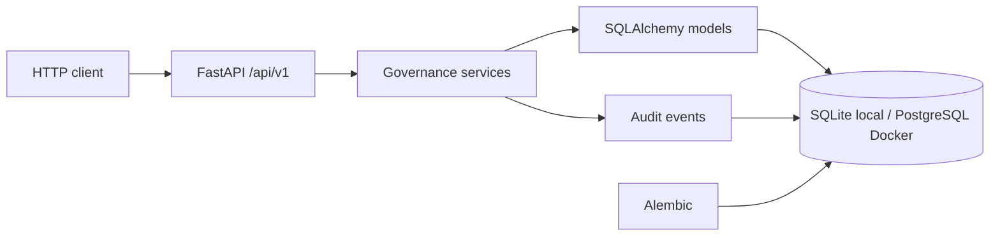
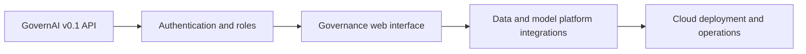

# Architecture

## Current request flow

Routers validate requests and shape responses. Services implement business rules and write domain changes and their audit events in one transaction. Alembic manages durable schema upgrades; metadata creation at app startup keeps a fresh local SQLite run convenient.

## Roadmap

